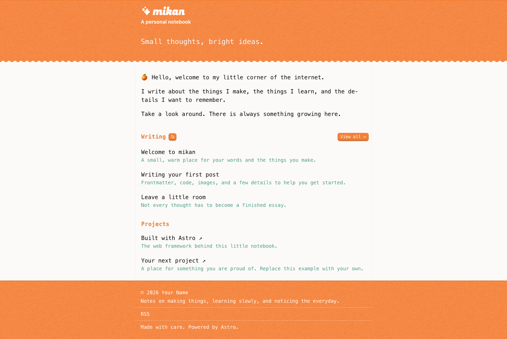
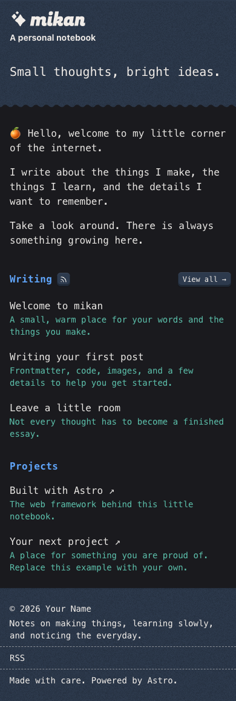

# mikan 🍊

[English](README.md) | [简体中文](README.zh-CN.md)

一个温暖、简洁的博客模板，基于 Astro、Tailwind CSS 和 MDX。留一小块地方，放下你的文字、作品和日常发现。

从 [Xat](https://github.com/withxat) 的个人网站整理而来，保留了橙色主题、纸张边缘和轻巧的交互。



<details>
<summary>移动端深色模式</summary>



</details>

## 特性

- **以写作为主。** 包含首页、分类归档、文章页和自定义 404 页面。
- **Markdown 与 MDX。** 支持代码高亮、中文排版，以及 MDX 文章中的图片灯箱。
- **统一配置。** 站点信息、个人介绍、社交链接和可选的作品区块都在一个文件里。
- **方便分享和订阅。** 自带 RSS 摘要、规范链接、Open Graph 元数据、自动生成的分享图、站点地图和 robots.txt。
- **舒适的阅读体验。** 响应式布局、跟随系统的深色模式、减少动态效果支持。禁用 JavaScript 后仍可阅读。
- **静态部署。** 可部署到 Netlify、Vercel 或其他静态托管服务，无需数据库、API 密钥或统计账号。

## 快速开始

推荐使用 **Node.js 24 LTS** 和 **pnpm 10.33.0**。最低支持 Node.js 22.18.0，`.nvmrc` 指定的是 Node 24。

克隆或下载仓库后，在项目目录中运行：

```sh
npm install --global pnpm@10.33.0
pnpm install
pnpm dev
```

打开 Astro 输出的本地地址，通常是 `http://localhost:4321`。

1. 编辑 `src/site.config.ts`，填写你的名字、介绍、链接和正式域名。
2. 将 `contents/posts/` 中的示例文章替换为自己的内容。
3. 修改 `contents/projects.json`，或将 `projects.enabled` 设为 `false`。
4. 替换 `public/favicon.svg`，在 `src/styles/globals.css` 中调整配色。
5. 运行下方的检查命令，然后部署生成的 `dist/` 目录。

## 改成你的博客

站点信息统一放在 [`src/site.config.ts`](./src/site.config.ts) 中。

| 配置项 | 用途 |
| --- | --- |
| `url` | 正式站点地址，例如 `https://your-domain.com` |
| `name`、`title`、`description` | 站点名称、浏览器标题和描述 |
| `author`、`lang` | 作者署名和 HTML 语言，例如 `zh-CN` |
| `tagline`、`hero`、`intro` | 首页文案 |
| `socials` | 社交链接、邮箱和 RSS |
| `projects.enabled`、`projects.moreUrl` | 是否展示作品区块，以及可选的完整作品集链接 |
| `postsPerPage` | 首页展示的最新文章数量 |
| `footer`、`ogImage` | 页脚文案和分享图路径 |

部署前，将 `https://example.com` 替换为正式站点地址。规范链接、RSS、站点地图和自动生成的分享图都会使用它。模板按域名根路径部署设计，不支持直接部署到子目录。

默认分享图会跟随站点名称、标语和域名生成。如果想使用自己的图片，将文件放入 `public/`，再修改 `ogImage`。

`lang` 用于设置文档语言。若要完整的中文界面，还需翻译 `src/components/` 和 `src/pages/` 中的界面文字。

### 社交链接

```ts
socials: [
  { href: 'https://github.com/your-name', label: 'GitHub' },
  { href: 'mailto:you@example.com', label: 'Email' },
  { href: '/feed.xml', label: 'RSS' },
]
```

将 `socials` 设为空数组即可隐藏社交导航；作品列表为空时，作品区块也会自动隐藏。

## 写一篇文章

直接在 `contents/posts/` 下创建 `.md` 或 `.mdx` 文件。文件名为 `hello-world.mdx` 的文章，对应 `/post/hello-world`。文章不支持嵌套目录，图片可以放在子目录中。

```md
---
title: 你好，世界
date: 2026-01-01
summary: 显示在首页和 RSS 中的简短介绍。
category: notes
tags: [你好, 写作]
draft: false
---

## 一个小小的开始

写下一件值得记住的事。
```

`title`、`date`、`summary` 和 `category` 为必填项。`tags` 默认为空数组，`draft` 默认为 `false`。分类必须对应 `contents/categories.json` 中的某个 `id`。

### 草稿与定时发布

设置了 `draft: true` 或未来日期的文章，不会出现在首页、归档、RSS 和站点地图中，也不会生成公开的文章页面。

发布状态在构建时计算。到达发布日期后，需要重新构建或部署。仅填写日期时使用 UTC；需要精确的发布时间时，请使用带明确时区的 ISO 时间戳。有仓库访问权限的人仍然可以查看草稿源文件。

开始写作后，可以删除全部示例文章，包括 `draft-example.mdx`。模板支持空博客。

### 图片与 MDX

将本地图片放在 `contents/posts/image/` 中，通过相对路径引用：

```md

```

需要自定义图片灯箱、引用和代码块样式，或导入 Astro 组件时，使用 `.mdx`。普通 `.md` 文件使用 Astro 默认的 Markdown 渲染方式。

RSS 提供文章摘要和全文链接，阅读器中不会出现 MDX 的导入语句或组件代码。

## 开发

| 命令 | 说明 |
| --- | --- |
| `pnpm dev` | 启动开发服务器 |
| `pnpm build` | 构建静态站点，输出到 `dist/` |
| `pnpm preview` | 在本地预览生产构建 |
| `pnpm lint` | 检查代码规范 |
| `pnpm lint:fix` | 应用 ESLint 自动修复 |
| `pnpm typecheck` | 检查 TypeScript 和 Astro 组件 |
| `pnpm test` | 测试文章发布规则和 URL |
| `pnpm test:build` | 检查已有构建的元数据、RSS 一致性和失效链接 |

提交前运行：

```sh
pnpm lint:fix
pnpm lint
pnpm typecheck
pnpm test
pnpm build
pnpm test:build
```

GitHub Actions 会在推送和拉取请求时执行 lint、类型检查、测试和生产构建。Lefthook 会在提交前修复暂存的源文件，并对 Astro 或 TypeScript 改动执行类型检查。提交信息使用 Conventional Commits 格式。

## 部署

| 平台 | 配置 |
| --- | --- |
| Netlify | 导入仓库即可，`netlify.toml` 已配置 Node 24、`pnpm build` 和发布目录 `dist`。 |
| Vercel | 按 Astro 项目导入，构建命令为 `pnpm build`，输出目录为 `dist`。`vercel.json` 配置了不带尾部斜杠的 URL。 |
| 其他静态托管服务 | 运行 `pnpm install --frozen-lockfile && pnpm build`，上传 `dist/`，并将不存在的路径交给 `404.html`。 |

无需服务端适配器。构建前，请先在 `src/site.config.ts` 中设置正式站点地址。

## 项目结构

```text
contents/
  categories.json       分类 ID 与描述
  projects.json         可选的作品列表
  posts/                Markdown、MDX 与本地图片
src/
  site.config.ts        站点信息与首页配置
  content.config.ts     内容数据结构
  components/           界面与 MDX 组件
  layouts/              页面布局与元数据
  lib/posts.ts          共用的文章发布规则
  pages/                页面、RSS、robots.txt 与分享图
  styles/globals.css    配色与排版
public/                 直接复制到构建产物的静态文件
```

## 技术说明

- 模板使用 Astro 7、Tailwind CSS 4 和 Motion 14。
- 通过 `@astrojs/markdown-remark` 保留 Astro 7 中的中文排版 remark 插件支持。
- 为兼容当前的 ESLint 解析器，TypeScript 保持在 6.0.x。
- Astro Check 通过限定范围的依赖覆盖使用 Chokidar 5。项目的 pnpm 来源证明策略会拒绝其原有的 v4.0.3 依赖。
- 标题字体使用 `@fontsource/fugaz-one` 提供的 Fugaz One，随站点托管，采用 OFL 许可证。正文使用系统等宽字体。

## 作者

**mikan** © [Xat](https://github.com/withxat)。<br>
由 Xat 与贡献者共同维护（[贡献者列表](https://github.com/withxat/portfolio/graphs/contributors)）。

> [Blog](https://blog.xat.sh) · GitHub [@withxat](https://github.com/withxat) · Telegram [@withxat](https://t.me/withxat) · X [@withxat](https://x.com/withxat) · Email [i@xat.sh](mailto:i@xat.sh)
