域名邮箱，老生常谈的话题，有一个代表自己风格的后缀绝对超酷的好吧。

除了在域名服务商那购买或获赠邮箱服务，也有许多免费的服务可以使用，比如 飞书企业邮箱、Zoho Mail 等。

我使用过腾讯企业邮箱，痛苦的登录验证劝退了我，后来转向 Skiff Mail，它有着很不错界面，虽然 iOS 端的 UI/UX 有些不合我的胃口，好在方便易用，但随着它被 Notion 收购，我也开始寻找替代方案。

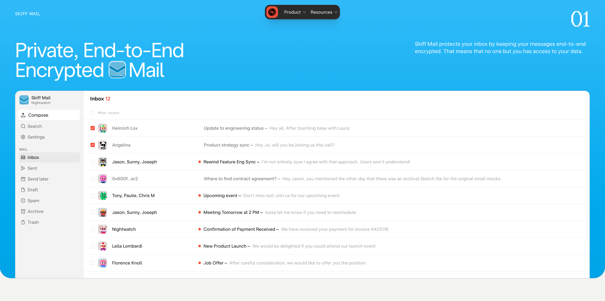

## Selection

首先明确自己的需求：

### 和 Gmail 集成

我的邮箱数量属实**不少**，不管是初中时用的 Sohu、163、Gmail，还是后来的 QQ 数字邮箱、QQ 英文邮箱、Outlook，林林总总算起来有十几个不同的邮箱。

能在一处地方管理，又能满足全平台的使用体验就太好了。

但如果是一个个去配置 IMAP/SMTP，就又太麻烦。

没有太多发送邮箱的需求，所以我选择将其他分支邮箱转发到 Gmail，在这里统一收取。

不选择 iCloud Mail 的原因是，我实在想象不到在网页端使用它的画面，也许之后可以尝试一下。

### 用域名收发邮件

emmm，作为域名邮箱，最基本的要求就是能够收和发邮件。

Cloudflare 提供了免费的 [邮件转发服务](https://www.cloudflare.com/developer-platform/products/email-routing/)，所以你可以配置好后，转发到你常用的邮箱（比如 Gmail，Outlook）。

但，Cloudflare 的邮件转发服务并不支持发送邮件，所以你需要一个支持 SMTP 的服务。

而 Resend 就是一个不错的选择，它提供了免费额度的 SMTP 服务，可以使用它来发送邮件。

> 截止行文，Resend 提供了每月 3000 封邮件的免费额度，一天最多 100 封，对我自己用来说已经绰绰有余了。

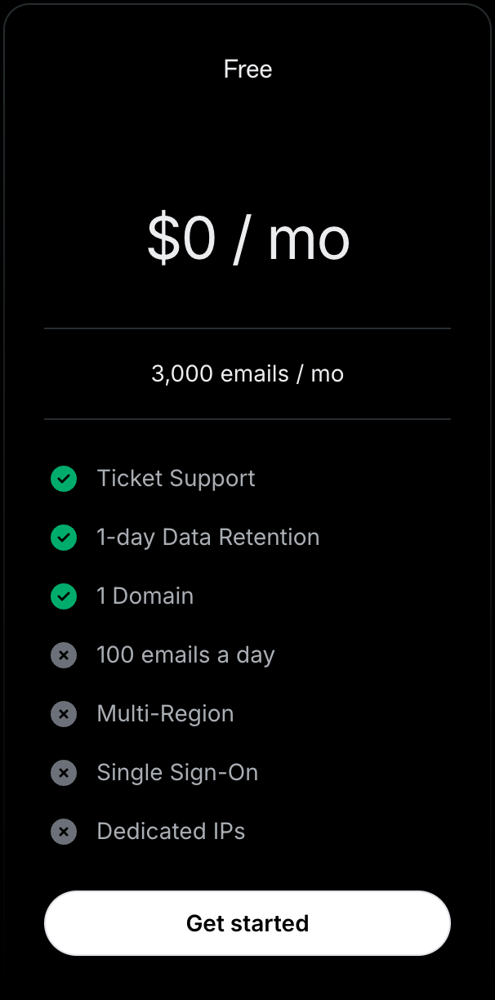

### Apple Mail

我不是一个忠实果粉，但我确实有一台 MacBook Air 和 iPhone，也更偏爱自带应用解决需求，所以 Apple Mail 是我首选的邮件客户端。

在 iOS 17 和 macOS 14 后，可以自动复制邮件验证码的功能也很吸引人（然而效果并不好，大部分时间识别不了邮件里的验证码，似乎对于纯文本的邮件识别率更高一些）。

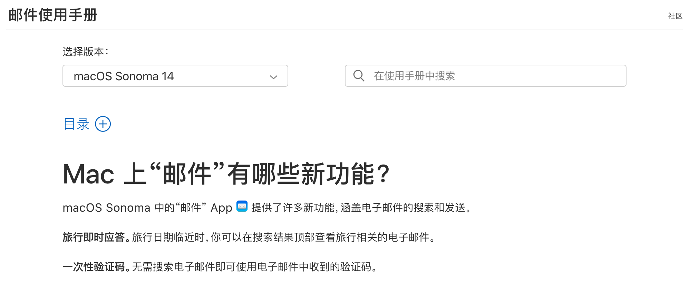

## Configuration

对于前两个需求，已经有了很多优秀的教程，比如 [域名搁着别浪费，Cloudflare + Gmail + Resend 十分钟轻松拥有免费的企业邮箱](https://cleanclip.cc/zh/developer/cloudflare-worker-gmail-resend-enterprise-email/)。

在这篇文章的基础上，这里就简单提一下配置步骤

### Cloudflare 转发至 Gmail

当然只要是能提供邮件转发服务的平台都可以，这里只是以 Cloudflare 为例。

1. 添加域名到 Cloudflare
2. 在侧边菜单栏选择 `Email - Email Routing`
3. 按提示添加 DNS 记录，添加用来接收邮件的 Gmail 到 Destination 里
4. 添加 `Routing rules`，可以像我选择 Catch-all，也就是任意 `xxx@yourdomain.com` 开头的邮箱都会转发
5. 填写 `Destination` 为你的 Gmail 地址

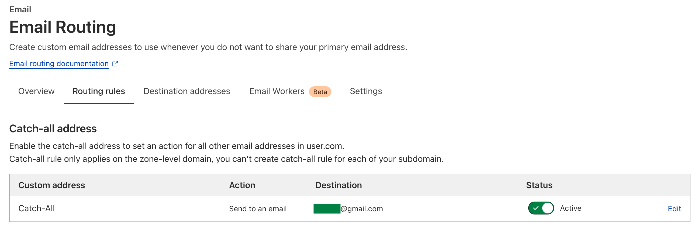

**需要注意的是，Catch-all 这里记得 Action 选择 `Send to an email`，默认似乎是 `Drop`，会直接丢弃邮件。**

这样，你的域名邮箱就可以收到邮件了。

### Resend 注册和配置

1. 注册 Resend 账号
2. 添加域名，验证域名
3. 创建你的 API Key，记住这个 Key，他是之后我们配置 SMTP 时的密码。（如果你和我一样有强迫症的话可以像我图上这样限制一下权限）

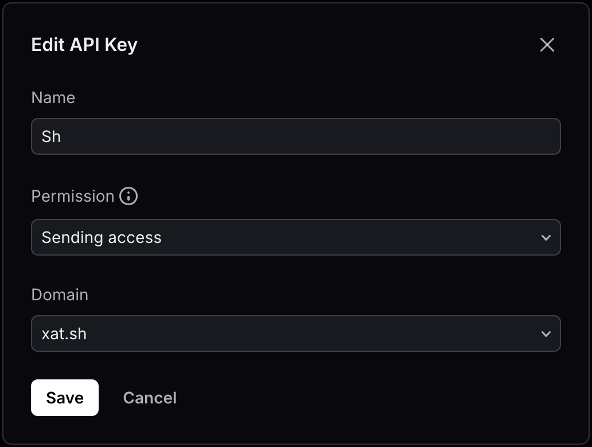

### Gmail 配置 SMTP

1. 在 Gmail 设置里找到 `Accounts and Import`，在 `Send mail as` 里选择 `Add another email address`
   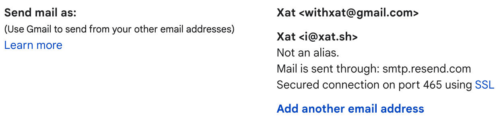
2. SMTP 信息填 Resend 给出的 [地址和端口](https://resend.com/docs/send-with-smtp#smtp-credentials)，密码则是你的 Resend API Key
   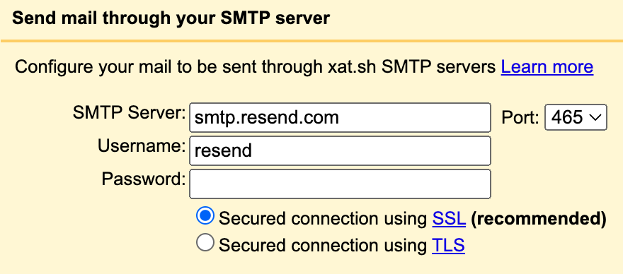
3. 点击 `Next`，Gmail 会给你发送一封验证邮件，验证后就可以使用了，你也可以在 `Accounts and Import` 里设置其默认发送邮箱

## Client

在完成上面的配置后，你已经可以用 Gmail 收发来自域名邮箱的邮件了，大部分的教程也结束在这里。

但需求还没结束，我并不想再下一个 Gmail 在手机上，并且隔一段时间整理软件，尽量减少使用的软件数量也是我的一个习惯。

接下来把域名邮箱配置到 Apple Mail 中吧。

1. 首先要在 Google Account 里 [添加 App Password](https://myaccount.google.com/apppasswords)，这个密码是用来**在 Apple Mail 中登录 Gmail** 的。
   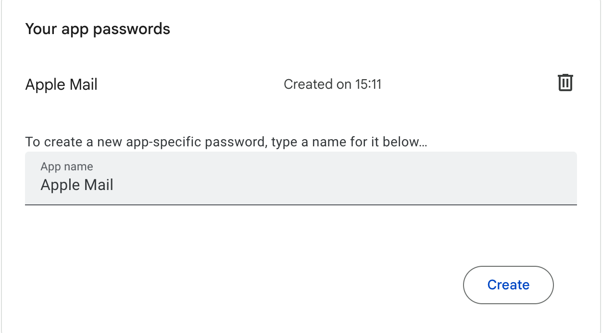
2. 在 Apple Mail 中添加账户，选择 `Other Mail Account`，填写你的域名邮箱，密码随意填写即可，这里只是触发编辑 SMTP 的界面。
   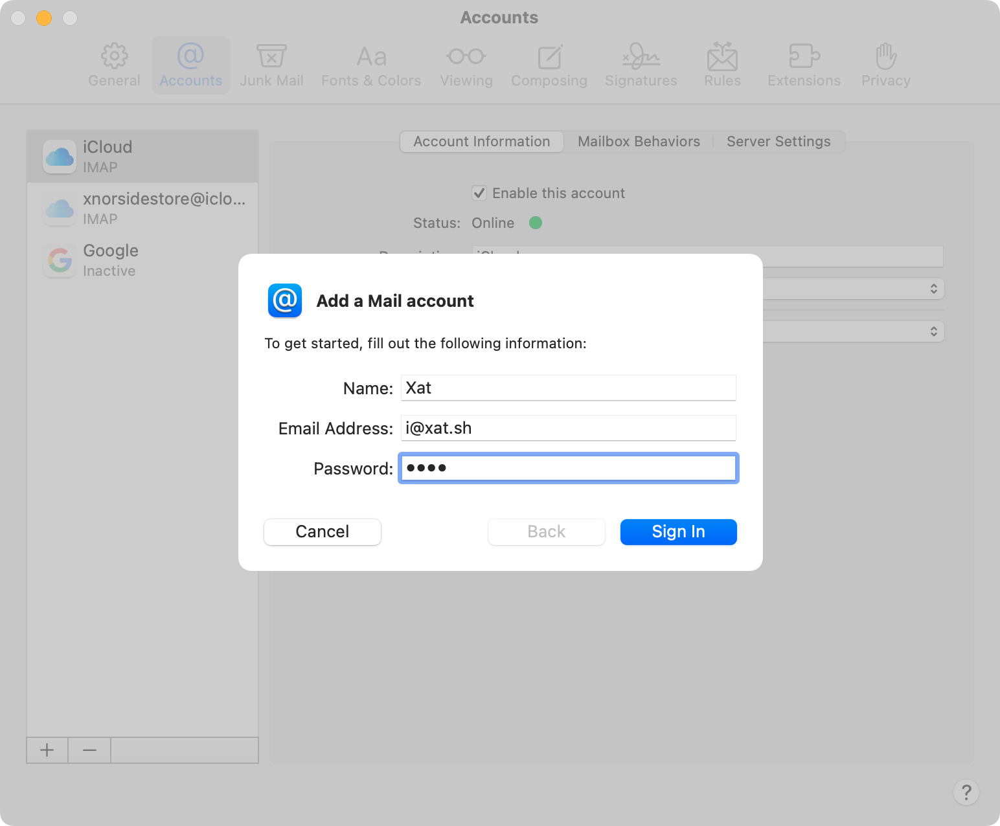
3. 在 SMTP 编辑界面，IMAP 服务器填写 `imap.gmail.com`，SMTP 服务器填写 `smtp.resend.com`，用户名和密码填写你的 Gmail 地址和生成的 App Password 或是 `resend` 和 API Key，任选一套组合即可。
   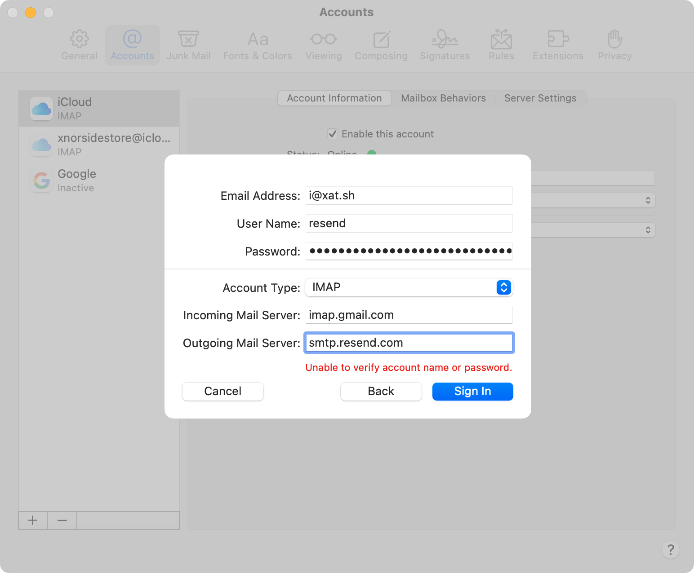
4. 保存后，你还需要为 IMAP 和 SMTP 分别设置不同的账户与密码，进入 Apple Mail 设置，账户，IMAP 使用 Gmail 地址和生成的 App Password，SMTP 使用 `resend` 和 API Key。
   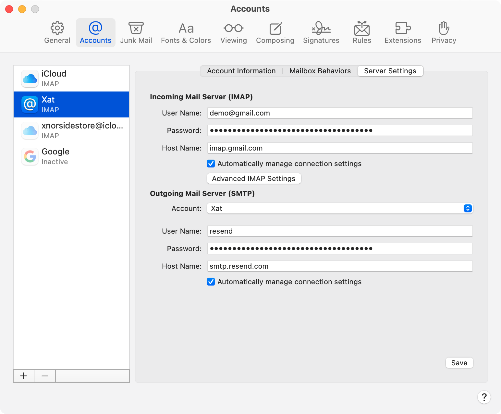
5. 即将完成啦，但还有一步，你要在 `Advanced IMAP Settings` 的 `IMAP Path Prefix` 里填上 `[Gmail]`，这样 Apple Mail 才能正确识别 Gmail 的文件夹。
   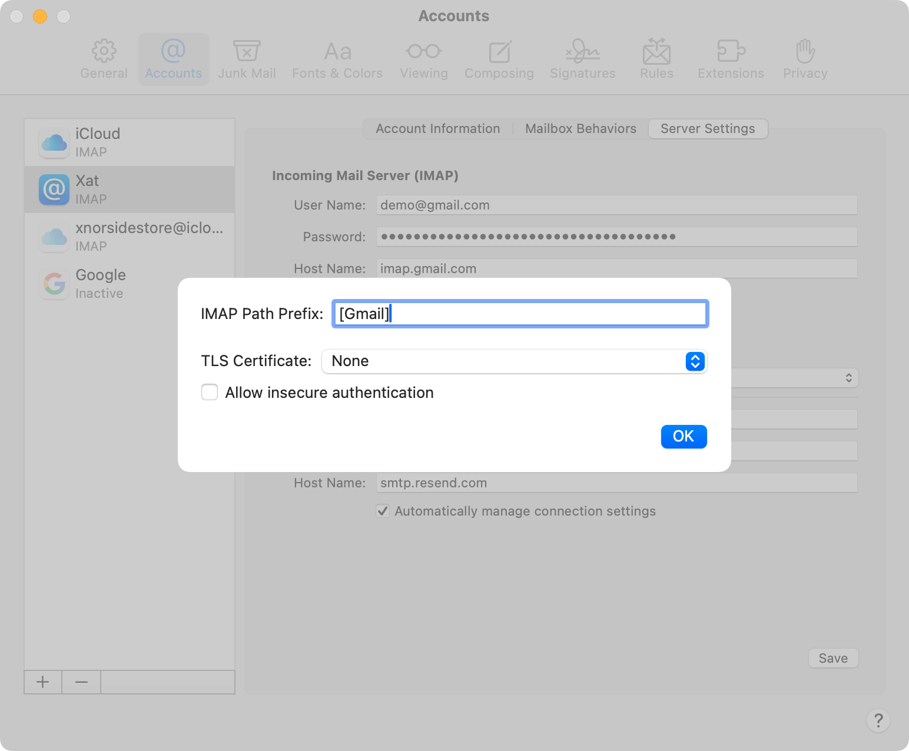
6. 最后别忘了点右下角的 `Save`，然后就可以愉快地使用域名邮箱啦。
   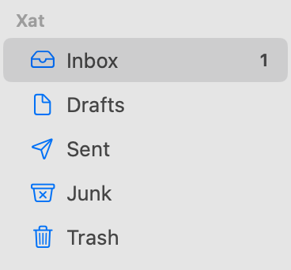

## Conclusion

Enjoy it!

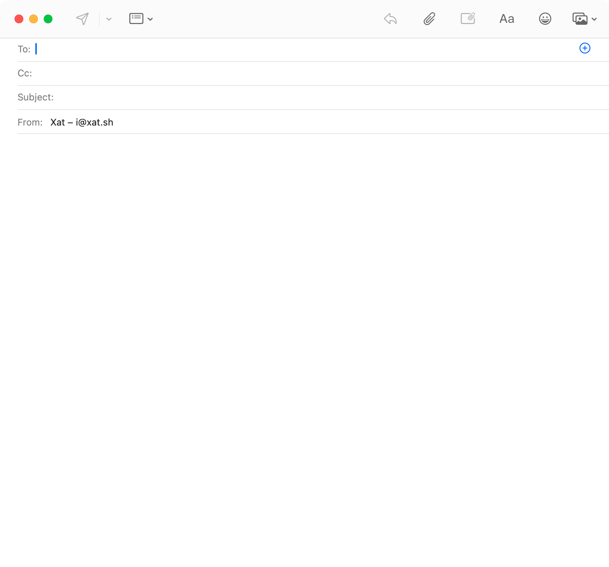
