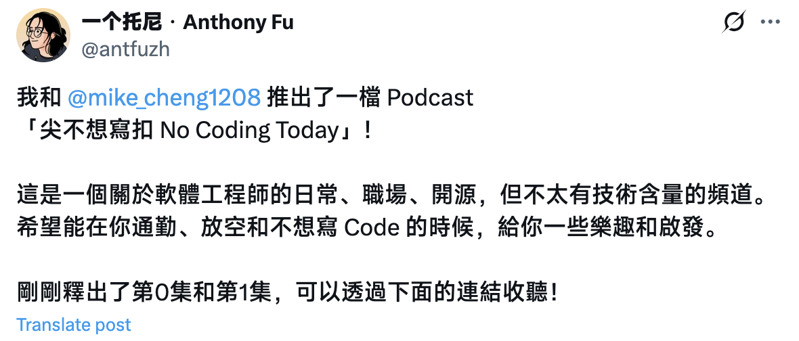
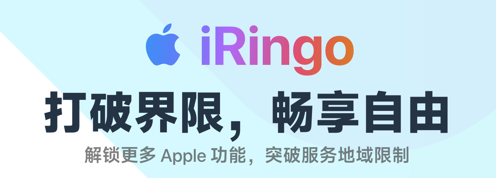
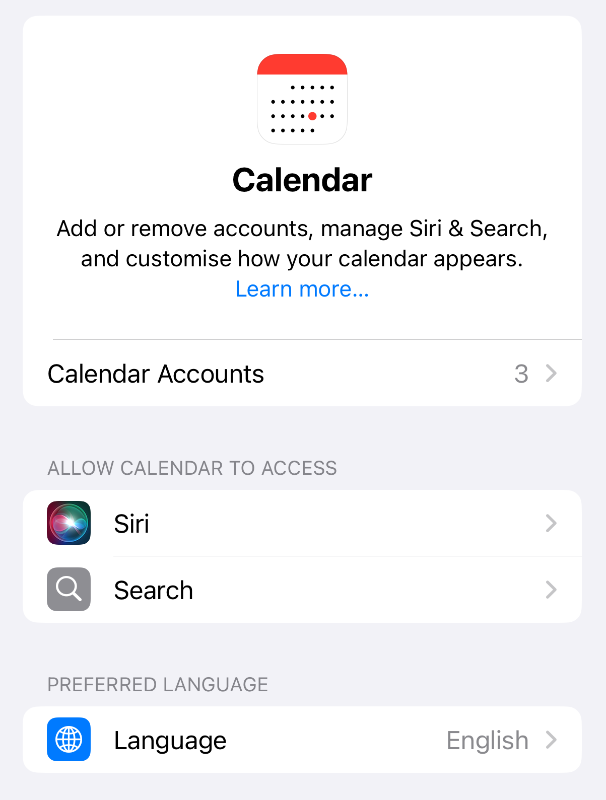
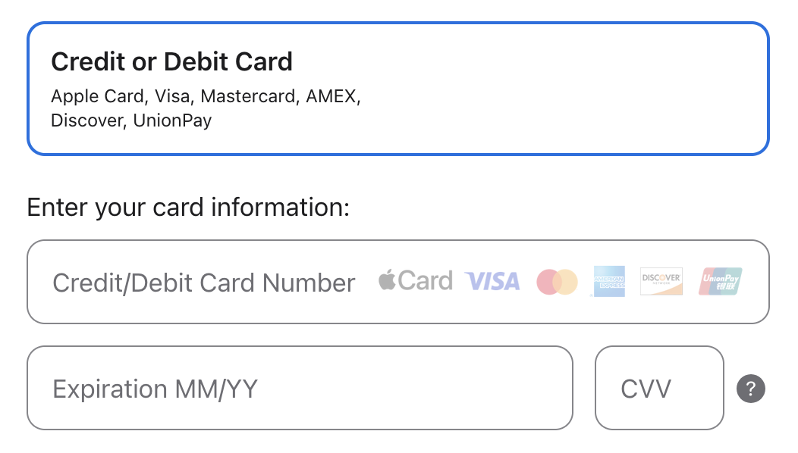
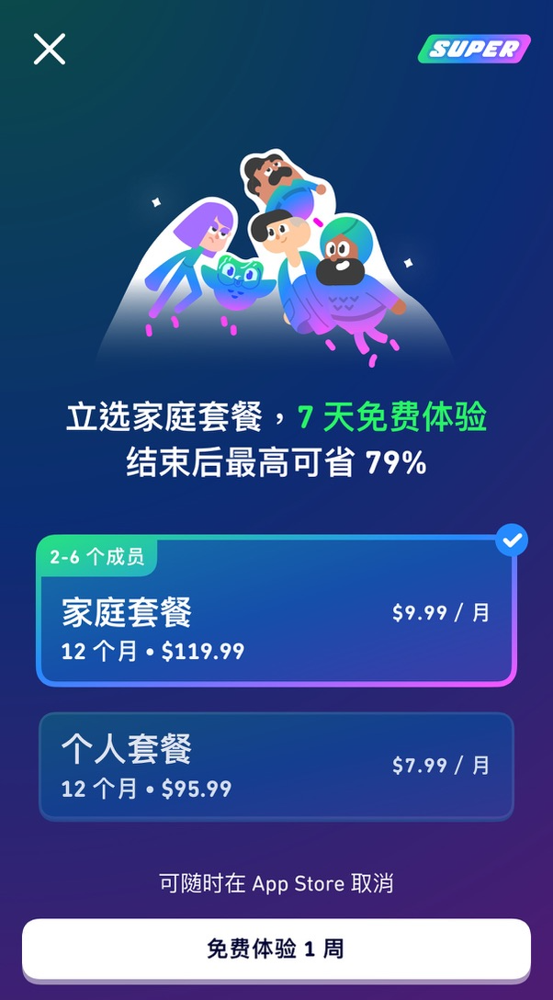
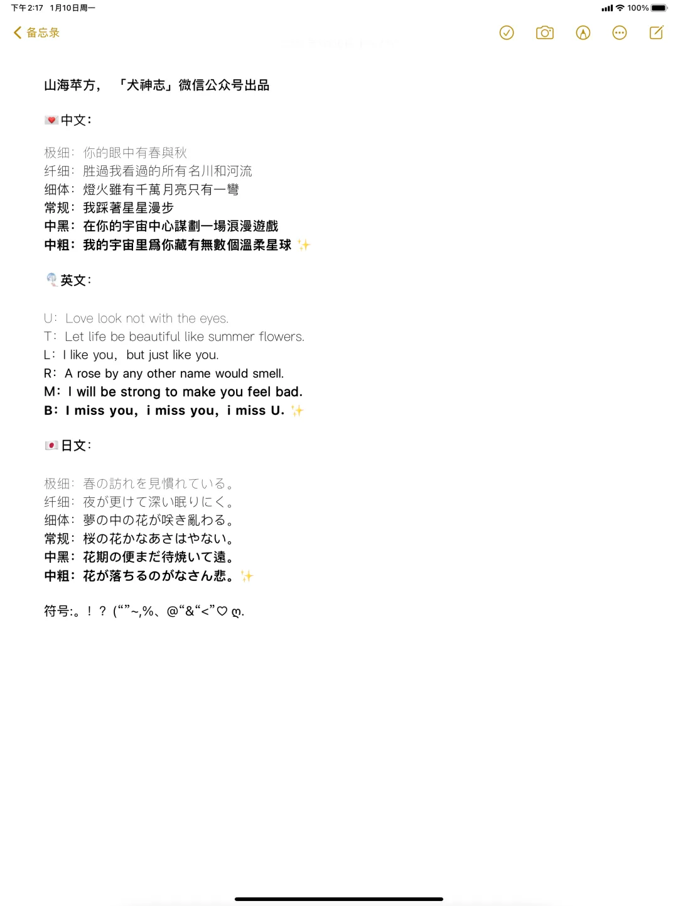
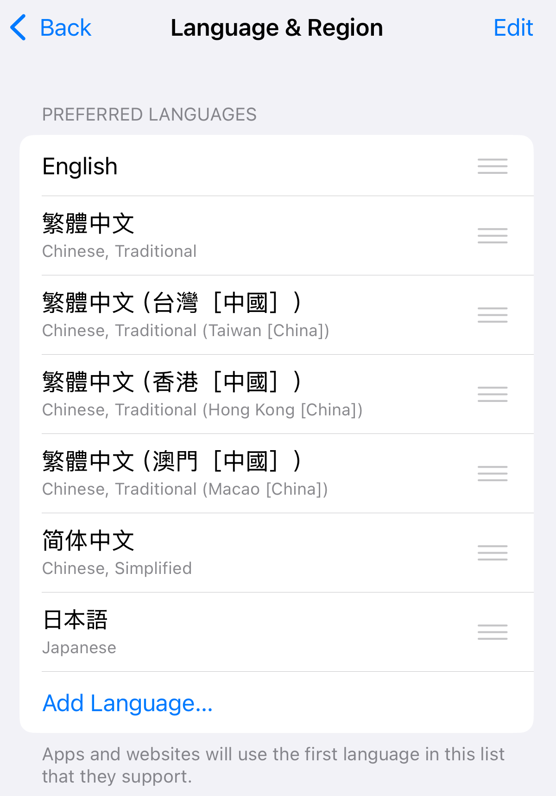

为了习惯英文语境，从我上手 iPhone 13 Pro（实际应该是在折腾 [黑苹果](https://en.wikipedia.org/wiki/Hackintosh) 时期）开始就把手头所有电子设备系统语言都设置为英文。

这样习惯了一段时间，一是想统一体验，二是~~国外的月亮的比较圆，~~安卓的使用体验让我形成了国际版总是优于国内版的刻板印象，于是也尝试将美区 Apple ID 作为主账号。

这里把我的体验和一些经验分享、记录一下。

## 软件生态 

刚开始会担心国内软件生态的缺失导致时不时得切回国区，实际上完全是多虑。

大部分社交软件有在美区上架的，仔细想想也是，毕竟很多海外留学的华人。

但也有必须切回国区的特例：

- 工商银行（ICBC），美区商店只有面向国际用户的 ICBC Mobile Banking。与此同时交行、中行、农行、招行、建行等等都是有国内版本的 App 上架的，反观宇宙行……
- 抖音、飞书，自然是因为海外有 TikTok，Lark。
- 麦当劳，美区的麦当劳 App 只面向美国本地，因为即使是美国人来了中国也只能老老实实 WeChat 或 Alipay 小程序点单。

总结起来，大部分 App 都有，一些国内外不同版本的应用，或是只面向国内的可能需要切回国区。

## Make it better

然而既然你都看到这了…想必也是对美区 Apple ID 做主力有一些兴趣，为了不跑题，下面就讲讲怎么让你的体验变好一些。

注册美区 Apple ID？这种教程一找一大片，很简单就懒得讲了。

### Apple, This way!

身在 China，想更好的美区体验必然少不了合适的代理分流，一般来说大部分 Apple 服务直连就可以，因为美区 App Store 国内是正常访问的。

我在大部分时间也一直是 Apple 全直连。

但这种情况在前一段时间出了问题。



[antfu](https://x.com/antfuzh/status/1896530111677227174) 推出了一档播客[「尖不想寫扣 No Coding Today」](https://bento.me/nocodingtoday)，提供了 Apple Podcast 链接。

然而，我打不开，或者应该说，它显示不存在。

好吧，其实我第一时间就猜到 Apple Podcast 是有锁国区存在的，但因为懒得去找具体的分流规则，索性一直没管。

后面刷到 V2EX 上的 [「苹果需要代理的域名有哪些」](https://www.v2ex.com/t/1135950)，#4 的这条对我来说很适用，推荐给大家。

> **li19910102**
> 
> 多年蘋果用戶，長期美區 ID 登錄，在國內使用總結出來的代理域名，覺得對你有幫助的煩請點個🌟
> 
> https://raw.githubusercontent.com/li2282231/Clash-rule/refs/heads/main/AppleProxy.list

支持作者喵，支持作者谢谢喵。

如果你只想知道具体规则或者链接失效的话：

```plaintext
# Apple Intelligence
DOMAIN-KEYWORD,apple-relay
# Apple FindMyDevice
DOMAIN,humb.apple.com
DOMAIN,fmipalservice.icloud.com
DOMAIN,p44-fmfmobile.icloud.com
DOMAIN,p44-fmf.icloud.com
DOMAIN,p44-fmip.icloud.com
DOMAIN,p44-fmipmobile.icloud.com
# Apple Podcasts
DOMAIN-SUFFIX,podcasts.apple.com
DOMAIN-SUFFIX,podbean.com
DOMAIN-SUFFIX,soundon.fm
DOMAIN-SUFFIX,fm
DOMAIN-SUFFIX,seahorseplanet.net
# Apple Books
DOMAIN,buy.itunes.apple.com
# Apple TV
DOMAIN,amp-api.videos.apple.com
DOMAIN,hls-amt.itunes.apple.com
DOMAIN,hls.itunes.apple.com
DOMAIN,np-edge.itunes.apple.com
DOMAIN,play-edge.itunes.apple.com
DOMAIN,tv.applemusic.com
DOMAIN,uts-api.itunes.apple.com
DOMAIN-SUFFIX,tv.apple.com
PROCESS-NAME,TV
# Apple iCloud Private Relay
DOMAIN,mask.icloud.com
DOMAIN,mask-canary.icloud.com
DOMAIN,mask-h2.icloud.com
DOMAIN,mask-api.icloud.com
DOMAIN,mask.apple-dns.net
DOMAIN,canary.mask.apple-dns.net
DOMAIN-SUFFIX,safebrowsing.apple
```

### 帮帮我！iRingo



简单介绍下 iRingo 这个项目，详细的可以去 [项目主页](https://nsringo.github.io/) 了解。

它能做到：

- 增强自带天气、地图等 App
- Testflight 地区切换
- 增强 Siri 推荐
- 自定义 Apple TV
- 解锁 Apple News

当然这个项目对国区也是（部分）起作用的。

前提是你有一个主流网络代理 App。

什么？你没有？那你注册美区 Apple ID 是干啥……

### 添加国区 Apple ID 账户

当需要的 App 在美区找不到时，我们会暂时切回国区下载。

然而每次在 App Store 里切换账户，必须接收一次短信验证码或其它的 [OTP](https://en.wikipedia.org/wiki/One-time_password)。

虽然退出、再登录的步骤必不可少，但接收验证码的一步是可以避免的，这会免去后续更新应用时（你在美区账户下也可以收到已下载的国区应用更新）的麻烦。

具体步骤就是在 **设置-Apps-邮件/日历/联系人** 中添加国区账号，这样 Apple 就会记住这台设备是受信任的设备，而不会触发验证。



### 付费方式

由于 App Store 限制绑定的银行卡必须与账号归属地一致，因此国内发行的 Visa、Mastercard、America Express，无论单标双标，一概是绑定不了的。

顺便一提，如果考虑的话，国内 JCB 卡由于本身的原因，是可以绑定日区 App Store 的。

于是只能曲线救国，主要有两种方式：

#### 礼品卡

渠道很多，最推荐当然是 Apple 美区官网购买，因为官网是不限卡种，银联信用卡也可以购买。



其次就是找靠谱的第三方了，我自己一直是在支付宝里的 PockytShop 里买的，自己感觉还算靠谱。

然后就是去咸鱼、淘宝等地方买，我没有购买过，就不做评价了。

很多人以为 App Store 里的试用订阅项目（比如 Apple Music 免费 3 个月、Duolingo Super 免费 7 天）不绑卡是没法购买的，实际上不是，你只要余额够试用过后的扣费就能成功订阅。

举个具体的例子：



Duolingo Super 家庭套餐，免费试用一周。

虽然它帮你算好了 $9.99/月，然而这是一个年付套餐，即一年续订一次，意味着一周后，Duolingo 会从你这里一次性扣 $119.99。

因此你需要通过礼品卡为账户充值余额，满足扣 $119.99 的要求，就能成功订阅试用。

当然，如果你不想真的被扣这么多就要记得**在试用到期前在 App Store 里取消订阅**！

#### Paypal

美区 Paypal 是可以绑定国内发行的 Visa、Mastercard、America Express 信用卡的，然后再将 Paypal 与 App Store 绑定。

然而首先美区 Paypal 本身的注册就比较困难，+86 是无法注册的，一种思路是通过向 Wikipedia 捐赠的方式绑定上 Google Voice，确实可以成功，但 Paypal 风控一直很严格，如果你的 IP 经常变动，很容易被限制且可能永久封锁，一旦被封，基本这张卡就无法再绑 Paypal 了，因为你没办法解绑。

当然如果你真的顺利完成了以上步骤，除非有稳定的 IP，最好再也不要再登 Paypal，平时正常通过 App Store 购买即可。

## 杂项

不得不说，iPhone 确实让我省了很多折腾手机的时间（因为 iOS 不给你折腾）。

但我也还是在这很长一段时间折腾了许多，也有了些经验。

### Apple ID 风控

网上常常有消息说外区 Apple ID 莫名被封，但就我自己这么长时间的使用，从来没有被封过，可能是幸存者偏差。

但我印象里确实有一次账号限制，具体表现为 App 内购项目或是付费应用，总是显示*这笔交易无法被完成*（当时还没将美区 ID 做主力，因为我记得这段提示是中文），解决方式是通过联系美区在线客服，似乎联系完后过了几十分钟就恢复正常了，不知道是否和客服有关联。

比较要注意的可能是黑卡购买的礼品卡导致的连坐。因为在自建代理前，我的 IP 也是跳来跳去，并没有出现被封号，我想如果真会因为 IP 频繁变动封号，应该会有很明显的用户反馈，但目前看来不是。

### 奇怪的字体

在使用安卓时期，我习惯折腾字体，记得「犬神志」公众号里有一个 [「山海苹方」](https://mp.weixin.qq.com/s/6bL9xRD7bH7xzcrKEbEnKQ) 的字体，具体描述记不清了，但喜欢这种字形奇艺的字体。



后面在 iOS 上大致复现了，具体原理就是 iOS 会支持字形覆盖，因此在系统语言里，按照不同的顺序便可以得出这样各式字形融合的效果。

如果有相同喜好的可以参考，但这个更偏向个人审美，可能并不适合所有人。



而且看久了其实再看正常国标字体有时候会觉得有些不适应。

That's it! Enjoy yourself!
